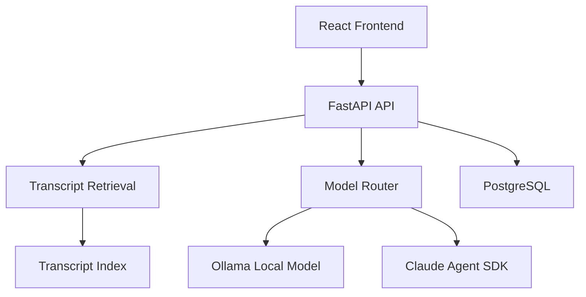
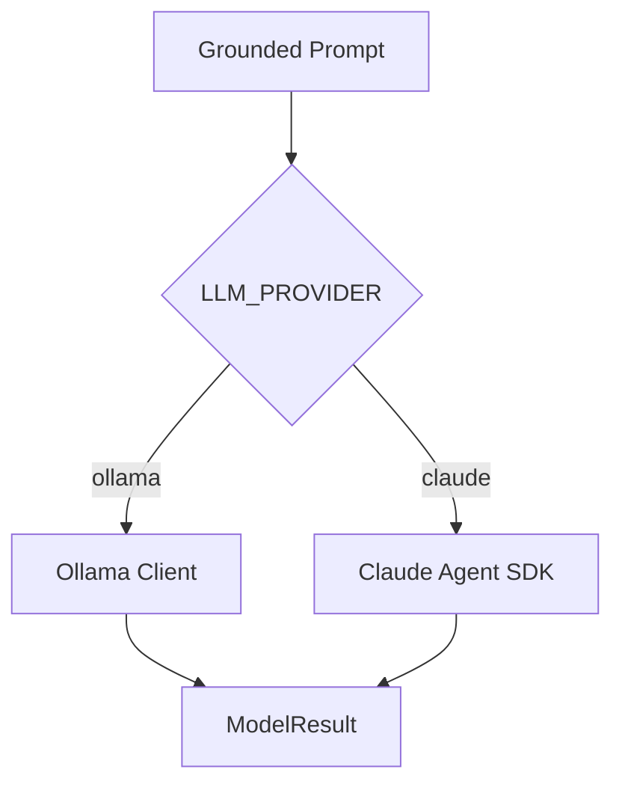
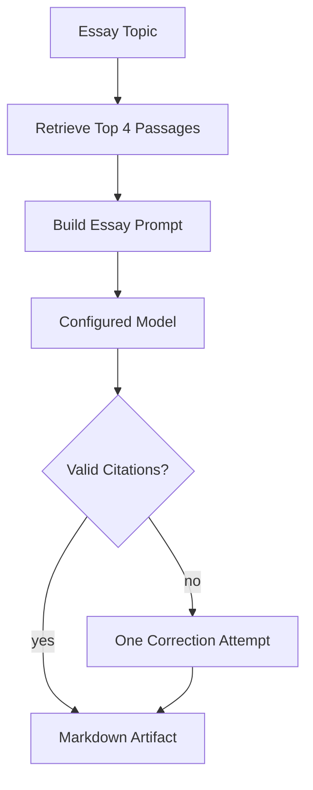
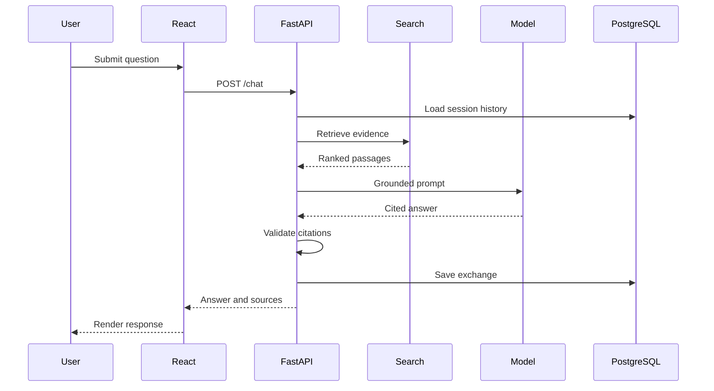

# Architecture

## System Overview

The application is organized into four main layers:

1. React presentation layer
2. FastAPI application and agent layer
3. Transcript retrieval and model-provider layer
4. PostgreSQL persistence layer



## Frontend

The React frontend is responsible for:

- Creating and selecting sessions
- Displaying conversation history
- Sending chat requests
- Displaying provider configuration
- Generating essays
- Rendering Markdown artifacts
- Displaying expandable transcript sources
- Deleting sessions
- Showing loading and error states

The frontend communicates with FastAPI over HTTP.

## FastAPI Backend

`main.py` defines the public API and coordinates the main workflow.

Responsibilities include:

- Request validation
- Session validation
- Non-blocking database calls
- Evidence retrieval
- Prompt construction
- Model invocation
- Citation validation
- Source construction
- Structured error responses

Blocking retrieval and database operations are executed with
`asyncio.to_thread` to avoid blocking the event loop.

## Retrieval Layer

`retrieval.py` loads the transcript search index once during application
startup.

For each request, it:

1. Accepts a search query.
2. Scores indexed transcript passages.
3. Returns the strongest matching passages.
4. Supplies transcript IDs, chunk IDs, URLs, and text.

Referential follow-up questions can reuse sources from the previous
assistant response.

## Grounding Layer

`grounding.py` creates prompts containing:

- The user's question
- Relevant transcript evidence
- Citation instructions
- Conversation history
- An exact insufficient-evidence response

The backend accepts citations such as:

```text
[1]
[2]
[1, 2]
```

It rejects responses that contain no citations or citations outside the
available evidence range.

## Agent and Model Layer

`model_router.py` provides one interface for multiple providers.



`ModelResult` contains:

- Generated answer
- Provider name
- Model name

### Ollama

`ollama_client.py` calls the local Ollama chat API. Responses are read
as a stream so long-form generation can continue without a fixed total
response timeout.

### Claude Agent SDK

The Claude provider uses the official Claude Agent SDK query interface.
Tools are disabled because the model only needs to transform supplied
transcript evidence into a grounded response.

### Fallback Policy

Automatic fallback is disabled. A provider failure returns an explicit
error instead of silently sending prompts to another provider.

## Essay Skill

`essay_skill.py` defines the "Ship 30 for 30" long-form writing skill.

The essay flow is:



The response includes:

- Artifact title
- Artifact type
- Markdown content
- Provider and model
- Cited sources

## Persistence Layer

PostgreSQL stores sessions and chat messages.

### `chat_sessions`

Stores:

- Session UUID
- Title
- User metadata
- Creation time
- Update time

### `chat_messages`

Stores:

- Message ID
- Session UUID
- Role
- Content
- Model
- Sources
- Grounding status
- Creation time

Foreign-key relationships keep messages associated with their session.
Deleting a session also deletes its messages through the application
transaction.

## Request Flow

### Chat Request



## Security Boundaries

- Model API keys stay in backend environment variables.
- `.env` files are excluded from Git.
- Raw generated HTML is not executed.
- Markdown is rendered with `react-markdown`.
- Source URLs are allow-listed to the expected GitHub repository.
- Cloud fallback is disabled.
- Request length is limited with Pydantic validation.

## Deployment Model

During local development:

- React runs on port `5173`.
- FastAPI runs on port `8000`.
- PostgreSQL runs on port `5432`.
- Ollama runs on port `11434`.

Docker Compose starts PostgreSQL. The application services can be
started separately with Python and npm, while Ollama remains a local
host service.

## Observability and Failure Handling

FastAPI and Uvicorn provide request and error logs.

The API returns structured status codes:

- `200` for successful reads and generation
- `201` for session creation
- `404` for missing sessions or evidence
- `422` for invalid input
- `502` for invalid model citation output
- `503` for database or model unavailability